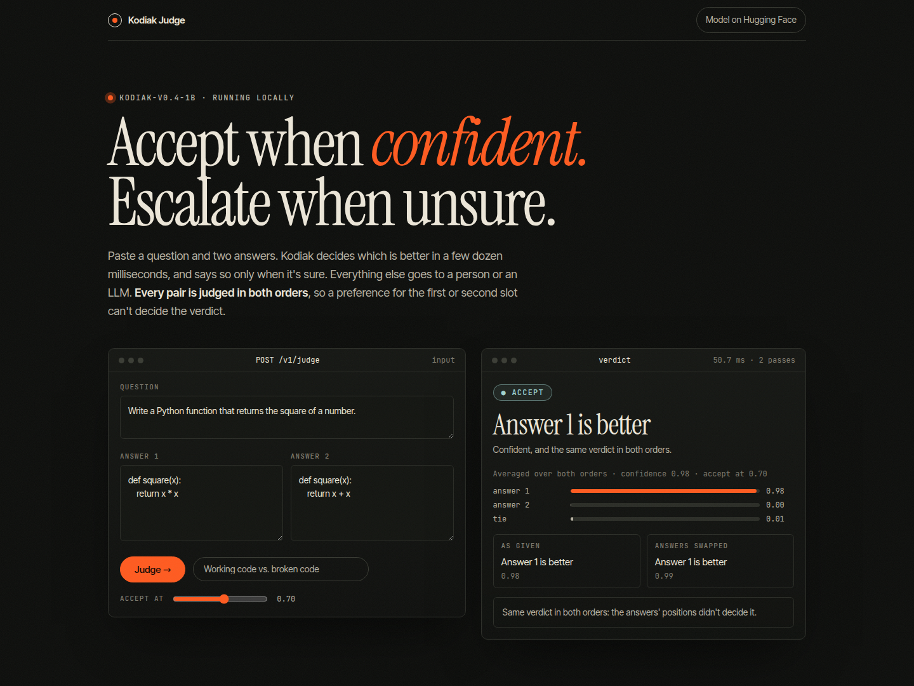

# Kodiak Judge

**Which of two answers is better? Accept when confident, escalate when unsure.** A local API and web page that use
[Kodiak-v0.4-1B](https://huggingface.co/cortex-agent-llc/kodiak-v0.4-1b), an open 1B decision model, as a fast first-pass judge. Verdicts
it is confident about are accepted; the rest go to a person or an LLM. The idea follows
[JEV-as-a-Judge](https://arxiv.org/abs/2609.26550).



## Position bias, handled

A judge can prefer whichever answer comes first (or second). On 150 expert-judged MT-Bench pairs, swapping the two answers changes 18% of
Kodiak's one-order verdicts. So every pair is judged **twice, once in each order**:

1. the two runs' probabilities are averaged, so position effects cancel in the score;
2. both verdicts are shown, so you can see when the order mattered;
3. if the two orders disagree, the pair is **escalated**, however confident one order looked.

## How good is it?

Measured on MT-Bench human judgments (150 pairs: 50 "first", 50 "second", 50 "tie"; random = 33%; CC BY 4.0), Kodiak-v0.4-1B, both orders
plus escalation on disagreement (`scripts/curve.py`, `reports/curve-v0.4-1b.json`):

| Accept at | Kodiak decides | Right when it decides | One order only |
|---|---|---|---|
| 0.6 | 68% | 64% | 60% of 71% |
| 0.7 | 57% | 67% | 63% of 59% |
| 0.8 | 43% | 71% | 68% of 49% |
| 0.9 | 35% | 69% | 67% of 35% |

Judged across everything, it is right 54% of the time. For reference, expert human judges on MT-Bench agree with each other about two
thirds of the time (MT-Bench paper). It is strongest where the verdict can be read off the text (a summary that invents facts, code that
does the wrong thing) and weak on world knowledge, where it usually escalates: a 1B encoder knows little about the world.

## Run it

Needs the [Kodiak](https://github.com/grizzlypeaksoftware/kodiak) repo checked out next to this one (see `pyproject.toml`), and a GPU
for best speed (CPU works, slower).

```bash
uv sync
uv run python -m kodiak_judge.server --curve reports/curve-v0.4-1b.json      # http://127.0.0.1:8790
# accuracy mode (3 models, ~3x compute):
uv run python -m kodiak_judge.server --model cortex-agent-llc/kodiak-v0.4-1b-accuracy --curve reports/curve-v0.4-1b-accuracy.json
```

`--host 0.0.0.0` makes it reachable from other machines on your network. There is no authentication; don't expose it to the internet.

## API

```bash
curl http://127.0.0.1:8790/v1/judge -H 'Content-Type: application/json' \
  -d '{"question": "...", "answer_1": "...", "answer_2": "...", "threshold": 0.7}'
```

```json
{"verdict": "first", "confidence": 0.98, "probs": {"first": 0.98, "second": 0.0, "tie": 0.01},
 "action": "accept", "reason": "confident, and the same verdict in both orders", "threshold": 0.7,
 "orders": {"as_given": {"verdict": "first"}, "swapped": {"verdict": "first"}, "disagree": false}, "ms": 50.7}
```

- `POST /v1/judge/batch` with `{"items": [{"question", "answer_1", "answer_2"}, ...]}` (up to 64 pairs)
- `GET /v1/info`: model, default threshold and the measured curve
- `GET /health`

In Python:

```python
from kodiak_judge import Judge
judge = Judge.load("cortex-agent-llc/kodiak-v0.4-1b", threshold=0.7)
judge.judge("Is 17 prime?", "Yes, 17 is prime.", "No, 17 is divisible by 3.")
```

## Limits

- Inputs are limited to about 8,000 tokens (question plus both answers); longer pairs are refused.
- Labels are first / second / tie; it is a pairwise judge only (no 1-10 scores).
- The measurement is one benchmark (MT-Bench). Check it on your own pairs before relying on a threshold.

Apache-2.0. Kodiak is built by Cortex Agent LLC; the model is Apache-2.0 on Hugging Face.
